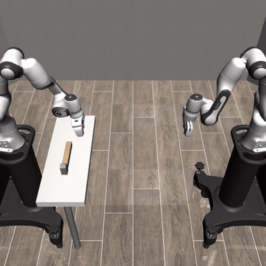
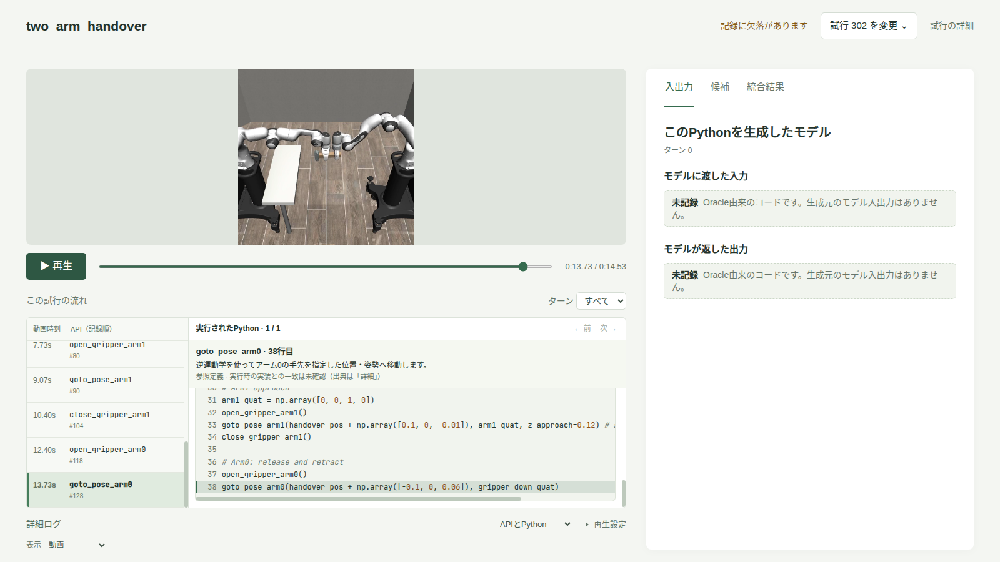

# CaP-X Replay Viewer

CaP-Xの録画を見ながら、その場面の観測、モデルの入力・回答、実行されたPythonをブラウザで確認するviewerです。
[nawta/capx-trace-viewer](https://github.com/nawta/capx-trace-viewer) の `35ce4bb` をベースに、既存の動画再生・フレーム同期・ログ表示を拡張しています。

## できること

- **左にMP4、動画の下に処理一覧、右に「入出力」「候補」「統合結果」の3タブ**を表示します。採用案Aに合わせて、設定・ID・詳細ログは必要なときだけ開く構成です。
- 再生・シークに対応する処理を強調します。同じ動画位置の処理も個別に選べ、停止したまま右の詳細を切り替えられます。
- SAM3の入力画像・対象指示・マスク、VDMの比較画像・説明、生成プロンプト・回答、実行Python・stdout/stderrを記録から表示します。
- 並列候補は1件ずつ選んで読み、統合結果は別タブで確認します。候補数は記録に従い、共通入力、temperature、エラー・打ち切りを確認できます。
- リプレイは最初から **「APIとPython」** で表示し、動画の下に時刻付きAPI一覧と実行Python全文を並べます。再生・シーク・APIの選択に合わせて、呼び出し行が見える位置までコード欄内をスクロールします。細かい記録は「詳細ログ」で確認できます。APIの説明はホバーで確認できます。右には、そのPythonを生成したモデルの入力と回答を表示します。[操作と記録条件](docs/replay.md#apiとpythonを同時に追う)
- 同期情報が足りない場合は「同期情報なし」と表示し、MP4の再生を維持します。保存されていない入力やマスクは復元・推定しません。

個人の接続設定・秘密鍵は含めません。起動すると、同梱の**デモ記録**（`demo/`）が開きます。GMOでQwen3.8-27Bが生成したコードによる `two_arm_handover`（seed 301）の1試行で、ターン0の失敗後にターン1で作り直して成功するまでを記録しています。アカウント名・パス・計算ノード名は伏せてあります。viewerは閲覧専用で、試行やモデル推論を開始しません。

## デモ映像

GMOで実行した `two_arm_handover`（seed 302）の録画です。2台のアームがハンマーを受け渡します。



[録画（MP4、14.53秒）](docs/media/gmo-two-arm-handover.mp4?raw=true)

## ビューアの画面例

GMOで実行した `two_arm_handover`（seed 302）の画面です。9.07秒の `goto_pose_arm1` を選択し、録画とAPIの引数・戻り値を表示しています。


「APIとPython」では、13.73秒の `goto_pose_arm0` に対応する実行コードの38行目が、動画と同時に見えます。



## GMOで使う

GMO上の記録は、手元へコピーしてから開けます。[公式ログイン手順](https://github.com/matsuolab/geniac_prize_2026_baseline/blob/main/docs/tutorial/01_login.md)の `Host gmo` をSSH設定に登録済みなら、追加設定は不要です。Linux・macOS、またはWindowsのWSL内で次を実行します。

```bash
bash Start-Replay.sh --from-gmo
```

接続先は `gmo`、共有の記録フォルダーは `~/shared-storage/traces` が既定です。`~/` は一覧取得と同じSSH接続内でGMOアカウントのホームへ展開し、解決した絶対パスを一覧表示と取り込みに使います。自分の `~/shared-storage/traces/<GMOのユーザー名>` と、チームの他のユーザーのフォルダーを探します。自分のユーザー名も同じ接続内で調べ、共有フォルダー内の実行者はユーザー名のフォルダー名です。

接続先や共有先を変える場合はGMOタブの「接続設定」、または設定ファイルを使います。設定ファイルがある場合はその値を使い、省略した項目は既定値になります。ファイルがない場合だけ `CAPX_GMO_HOST` と `CAPX_GMO_TRACES` が既定値より優先します。共有フォルダーを使わない場合は欄を空にして保存するか、設定ファイルに `"shared_root": ""` を指定します。従来の自分・チームのパターンは「場所を個別に指定する（詳細）」で追加でき、共有フォルダーと足し合わせます。同じ場所は重複表示せず、自分とチームの両方に一致した記録は自分として扱います。詳しくは **[GMOの記録を手元へ取ってくる](docs/gmo.md#gmoの記録を手元へ取ってくる)** を参照してください。

`--from-gmo` は起動前に新しい自分の記録だけを `outputs/gmo/traces` へ取ってきて、サーバーの `--gmo` も有効にします。設定ファイルがなくても既定値で取り込みます。接続できない場合はSSH設定や「接続設定」の案内を表示してサーバーを起動し、「手元の記録」は引き続き使えます。`--gmo` で動いている間、サーバーは共有フォルダー内の自分の場所と個別に指定した自分のパターンを指定の間隔ごとに確認し、新しい・更新された試行を自動で取り込みます。GMOタブの「接続設定」にある「自動取り込みの間隔」で、1分・2分（既定）・5分・取り込まないを選び、「保存して確かめる」で保存できます。設定ファイルの `interval_s`（秒、0で無効）でも指定でき、変更は次の巡回から反映されます。記録中の試行も追いかけます。1回の巡回の転送予定量は合計1 GiB未満で、超える分は手動で取り込みます。GMOタブで一時停止・再開でき、チームの試行は同じタブから選んで取り込みます。[自動取り込みの詳しい条件](docs/gmo.md#gmoの記録を手元へ取ってくる)

GMO連携が有効なら「試行を選ぶ」は最初に「GMO」を開き、一覧から「取り込む」→「開く」と進めます。保存済みのトレースは「手元の記録」、旧形式のrunnerログは「古いログ（トレースなし）」で選びます。古いログのボタンはログがある場合、または旧形式の試行をURLで開いている場合に表示します。連携が無効なら最初に「手元の記録」を開きます。選んだタブはピッカーを開き直しても保ちます。[一覧の表示条件と操作](docs/replay.md#操作)

viewerをGMOの計算ノードで動かす場合は **[GMOへの接続・計算ノードでのセットアップ・ブラウザ接続](docs/gmo.md)** を参照してください。
ログインノードでインストールや長時間のviewer起動をせず、計算ノードで動かしてSSHで手元のブラウザへ転送します。録画の閲覧にGPUは不要です。

計算ノードは他のチームと共有しています。`127.0.0.1` のTCPポートで待ち受けると、同じノードで動く他のチームのジョブからも接続でき、トレース（プロンプト、モデルの回答、生成コード、画像）を読まれます。計算ノードでは `--uds PATH` を付けて、`$HOME` の下のパーミッション0700のディレクトリに置いたUnixドメインソケットで待ち受け、手元から `ssh -L 127.0.0.1:18390:/ソケットの絶対パス` で転送します。ディレクトリが自分の所有で0700でなければ起動しません。[公式ルール §10.5](https://github.com/matsuolab/geniac_prize_2026_code/blob/main/PRELIM_RULEBOOK.md#105-計算ノードで立てるサーバー)

GMOから取得済みの記録はローカル環境で表示確認していますが、**GMOの計算ノード上でのviewer起動と、そのノードのソケットへのSSH転送は未確認**です。`--uds` のソケットでの応答と権限の検査はPythonテストで確認しています。ノードの接続制限は利用環境の案内に従ってください。

### 記録を作る

チームのhype-agentは、route A（`target=bench`）の試行を標準で記録します。記録用の `capx_trace_recorder` は同梱済みです。記録を止めるには `trace=none` を指定します。`target=package` では記録しません。

チームの記録先は `~/shared-storage/traces` です。各メンバーのGMOホームにある `~/shared-storage` は共有ストレージへのリンクで、記録は `~/shared-storage/traces/<GMOのユーザー名>/<run id>/<episode>/…` に保存します。hype-agent側も `HYPE_TRACE_ROOT` の既定値をこの共有先に揃えるため、viewerと同じ場所を使えます。その既定値に未対応のhype-agentでは `HYPE_TRACE_ROOT="$HOME/shared-storage/traces"` を指定してください。共有先を変える場合は、hype-agentの `HYPE_TRACE_ROOT` とviewerの「共有の記録フォルダー」を同じ場所にします。

hype-agent以外でCaP-Xを直接動かす場合は、従来どおり[記録器の導入と `CAPX_TRACE_DIR` の設定](docs/upstream-readme.md#recording-traces)を使います。

## 評価を記録して比べる

`python -m capx_trace_recorder eval --changed "変更した部品" --baseline <基準の評価ID> -- <評価コマンド>` で評価を記録し、試行画面の「評価一覧」から基準との比較や試行の録画・ログを開けます。GMOでは `CAPX_TRACE_DIR` が空でも、`HYPE_TRACE_ROOT` または既存の `~/shared-storage` から自分の記録先を選びます。`Host gmo` が設定済みなら、各メンバーは `bash Start-Replay.sh --from-gmo` だけで共有先の評価を見られます（[実行方法・保存先の優先順位](docs/evals.md)）。

評価の開始時と終了時に、全員の結果を1ファイルにまとめた `~/shared-storage/traces/index.html` も更新します。GMO上で直接開くかPCへコピーすると、Viewerを起動せず一覧を読めます。失敗した試行はViewerで開けます。手動の再生成は `python -m capx_trace_recorder index --root ~/shared-storage/traces`、自動更新の停止は `CAPX_EVAL_INDEX=0` または `eval --no-index` です（[HTML一覧の使い方](docs/evals.md#viewerを起動せず一覧を見る)）。

## 対応環境

| サーバーを動かす環境 | 起動方法 |
|---|---|
| Linux | `bash Start-Replay.sh` |
| macOS（Apple Silicon / Intel） | `bash Start-Replay.sh`。PythonとNode.jsはそのMac用のものを使います。 |
| Windows | WSL/Ubuntu内でサーバーを動かす `Start-Replay.ps1` |

ブラウザでの閲覧はWindows・Linux・macOSで共通です。GMOなど別のLinuxマシンでサーバーを動かす場合、手元にはブラウザとSSHだけあればよく、手元へのPython・Node.js・WSLの導入は不要です。

録画済みの閲覧・デモ記録にCaP-X本体やGPUは必要ありません。OSごとの実行確認範囲は[検証](#検証)に記載しています。

## Linux / macOSでデモを起動する

必要なものはGit、Node.jsとnpm、Python **3.10～3.12**です。対応するPythonが見つからない場合は、導入済みの `uv` でPython 3.12を取得することもできます。開発時の構成はPython 3.12、Node.js 24.19.0、npm 11.17.0です。macOSの標準ターミナルからも同じコマンドを実行できます。

```bash
git clone https://github.com/Kitatani819/capx-replay-viewer.git
cd capx-replay-viewer
cd web-ui
npm ci
npm run test:trace
npm run build
cd ..
bash Start-Replay.sh
```

同じPCのブラウザで **http://127.0.0.1:8390/traces** を開きます。停止はサーバーの端末で `Ctrl+C`。
初回は専用のPython環境へ依存パッケージを導入し、同梱のデモ記録 `demo/` を開きます。環境の保存先はLinuxで `~/.cache/capx-geniac-replay`、macOSで `~/Library/Caches/capx-geniac-replay` です（`XDG_CACHE_HOME` を指定した場合はそちらを使います）。OSのPython環境や別のプロジェクトの仮想環境は変更しません。

2回目以降はプロジェクト直下で `bash Start-Replay.sh` を実行します。更新後に画面をビルドし直す場合は `web-ui` で `npm ci` と `npm run build` を実行してください。

デュアルブートのUbuntuでは、Ubuntu側のホームディレクトリにこのリポジトリを取得して、この手順を実行してください。Windows側の `.venv` や `node_modules` はOSごとの実行ファイルを含むため流用しません。録画・ログは、Ubuntuから読める保存先を `--trace-root` / `--runner-root` で指定できます。

自分で用意したPython環境を使う場合は、必要なパッケージを導入して明示できます。この指定ではランチャーからパッケージを追加しません。

```bash
python3.12 -m venv .venv
.venv/bin/python -m pip install -e '.[dev]'
bash Start-Replay.sh --python .venv/bin/python
```

操作は **試行を選ぶ → 再生 → 気になる場面で停止 → 動画下のログを選ぶ → 右の入出力 → 候補 → 統合結果** です。[操作の詳細](docs/replay.md)も参照してください。

## 自分の録画・ログを開く

```bash
bash Start-Replay.sh --port 8390 \
  --trace-root /absolute/path/to/traces \
  --runner-root /absolute/path/to/runner
```

指定するのは各試行の親となるルートディレクトリです。`--trace-root` は `<run>/<episode>/events.jsonl` を含む親、`--runner-root` は `<run>/run.json` と `<run>/<task>/<condition>/trial_*/` を含む親です。詳しい配置は[データの置き方](docs/replay.md#データの置き方)を参照してください。

MP4だけの記録もrunner形式で表示できますが、処理ログがなければ同期や入出力表示はできません。同じ試行の動画・ログ・画像をまとめて指定してください。

既存の `.venv/bin/python -m capx_trace_viewer.server --viewer-only ...` による直接起動も引き続き使えます。複数のrunnerルートや別のフロントエンド配信先などを指定する場合は、この起動方法を利用してください。

## Windows / WSL

ローカルでサーバーを動かす場合は、WSLのUbuntuと、その中で利用できるPython 3.10～3.12または `uv` が必要です。リポジトリを取得後、PowerShellで実行します。

```powershell
cd web-ui
npm ci
npm run test:trace
npm run build
cd ..
.\Start-Replay.ps1
```

このランチャーはLinux / macOSと共通の起動処理をWSL内で実行し、専用のPython環境を作って同梱のデモ記録を開きます。初回は依存パッケージを取得します。`uv` を使う場合は必要に応じてPythonも取得します。

```powershell
.\Start-Replay.ps1 -Port 8391 -TraceRoot 'C:\data\traces' -RunnerRoot 'C:\data\runner'
```

Linux / macOSの安全なファイル読み出し機能を利用するため、WindowsネイティブのPythonでサーバーを動かす構成はサポートしていません。対応しない環境では起動時に案内を表示します。Windowsのブラウザでの閲覧やOpenSSHによるGMOへの接続には、この制限はありません。

## 検証

```bash
python3.12 -m venv .venv
.venv/bin/python -m pip install -e '.[dev,demo]'
cd web-ui
npm ci
npm run test:trace
npm run build
cd ..
.venv/bin/python -m pytest tests -q
.venv/bin/python -m playwright install chromium
```

ブラウザ操作の確認は、同梱のデモ記録ではなく合成デモで行います。合成デモを作り、それを指定して起動します（`outputs/geniac_demo` が既にあれば作成は不要です）。

```bash
.venv/bin/python scripts/make_replay_demo.py --out outputs/geniac_demo
bash Start-Replay.sh --python .venv/bin/python --trace-root outputs/geniac_demo/traces --runner-root outputs/geniac_demo/runner
```

起動したまま、別端末で次を実行します。

```bash
.venv/bin/python scripts/demo/check_replay_layout.py --base-url http://127.0.0.1:8390
```

GitHub ActionsでLinux・macOSのバックエンドテスト、フロントエンドのテストとビルド、合成デモのブラウザ操作を実行します。[2026-11-17のデモ記録差し替え時の検証結果](https://github.com/Kitatani819/capx-replay-viewer/actions/runs/44028714381)は両OSとも成功です。

| 環境 | Pythonテスト | フロントテスト / ビルド | ブラウザ操作 |
|---|---|---|---|
| Ubuntu（GitHub Actions、x86_64） | 1,513成功・26スキップ | 255成功 / 成功 | 19項目成功・例外0 |
| macOS 26（GitHub Actions、Apple Silicon） | 1,466成功・73スキップ | 255成功 / 成功 | 19項目成功・例外0 |

手元のWSL/Ubuntuでは、今回Linuxブラウザ操作16項目が成功しました。前回のPythonテスト1,491件、初回Python環境作成（通常のvenvとuv）からの起動、Windowsで未対応理由を案内するテストも成功しています。Intel Macと、このPCをデュアルブートのUbuntuで起動した状態の実機確認は未実施です。

ビルドは成功しますが、ブラウザ互換性データの更新案内と、gzip圧縮前のJavaScriptが500 kBを超える警告が残っています（約503 kB、gzip後約166 kB）。

確認した内容:

- 2026-11-16のAPI/Python試作では `test:trace` 214件、ビルド、WindowsとWSL/Linuxのブラウザ16項目が成功。`goto_pose`と3行目の同時表示、ホバーで位置・選択が変わらないこと、同時刻の個別選択、前後コード、正確な生成元入出力、既存3タブを確認。最初のAPIより前への巻き戻しと、ターンフィルターの選択不一致には回帰テストを追加しています。

- 合成デモで再生・停止、SAM3・VDM・Pythonの入出力、候補・統合結果を確認。GMOから取得済みの記録のローカル表示は前回検証で8項目成功しています。OS別CIのブラウザ操作には合成デモだけを使います。同梱のデモ記録は、Pythonテストで記録が完全であることと、アカウント名・パス・GMOのホスト名を含まないことを確認しています。
- 同位置の複数イベント・候補選択、停止位置の保持、マスクの拡大、未記録の表示、MP4のみ、狭幅・動きを減らす設定を確認。
- モデル呼び出しだけに絞った状態からPythonへ移動すると対象行が隠れる問題と、録画切替後に再生ボタンの状態が残る問題を修正。
- 一覧から開いた直後のSAM3選択と右欄の一致、イベント指定URL、再生中・Live中の履歴移動、候補9件／3件、デバッグ表示が1組だけになること、注意帯の指定配色（約8.22:1）を確認。
- OS別検証で見つかった詳細ログのスクロール補正による連続更新を修正し、旧実装では失敗する回帰テストを追加。macOSに存在しない `/proc` に依存していたレコーダーのテストも、ファイルの識別情報を使う方法へ修正。
- 実行中の応答をブラウザ内で模擬し、Liveの新着追従、再生による閲覧への切り替え、Live再開時の動画停止を確認。実際のGMO上で記録中の試行を使ったLive検証は未実施です。

トレースを記録したGMOの `two_arm_handover`（seed 301、Oracle）で、APIとPythonの同期表示とシーク位置の保持を確認しました。Chromeでseed 302の13.73秒の動画と38行目を同時に表示できることも確認しました。

2026-11-17には、GMOでQwen3.8-27Bが生成したコードを実行した `two_arm_handover`（seed 301）を記録し、同梱のデモ記録にしました。モデル呼び出し22件（VDM 2件、候補18件、統合2件）すべての要求と回答、SAM3の50件のマスク、候補・統合結果・ターンごとの入出力を表示できることを確認しています。記録は完全で、欠落はありません。呼び出し行には `call_site`、モデル入出力には `source_model_event_id` と要求・回答の記録が必要です。 [操作と検証](docs/replay.md#検証)

2026-11-18には、実際のGMOで自動取り込みを確認しました。空のフォルダーで起動し、最初の巡回で自分の試行（17.3 MB）を取り込み、次の巡回では取り込みなしでした。GMOで `cube_lifting` を2試行（seed 402・403、GPU 1枚で約10分）記録して取り込み、API呼び出し14件・13件と、同梱の `two_arm_handover`（seed 301）の37件すべてでAPIの説明を表示でき、「説明未登録」はありませんでした。OS別CI（Linux・macOS）のブラウザ確認19項目も成功しています。

## 記録形式とライセンス

- [trace-format](docs/trace-format.md): イベント・payload・画像・フレーム・同期の仕様。
- [元viewerのREADME](docs/upstream-readme.md): recorderの導入、元の画面、詳細な検証方法。
- [MIT License](LICENSE): 上流のライセンスと著作権表記を保持しています。

サーバーに認証機能はありません。既定の `127.0.0.1` のまま利用し、遠隔閲覧にはSSH転送を使ってください。GMOの計算ノードのように他のユーザーと共有するマシンでは、`127.0.0.1` にも他のユーザーが接続できるため、`--uds` で待ち受けてください。GitHubリポジトリの非公開設定は、起動したHTTPサーバーへのアクセス制御にはなりません。
