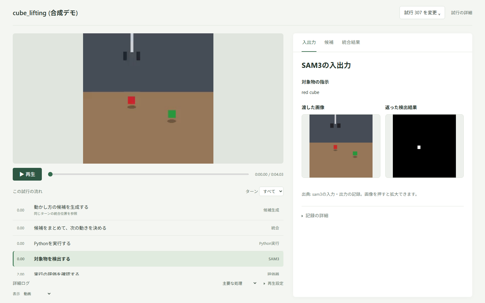

# CaP-X Replay Viewer

CaP-Xの録画を見ながら、その場面の観測、モデルの入力・回答、実行されたPythonをブラウザで確認するviewerです。
[nawta/capx-trace-viewer](https://github.com/nawta/capx-trace-viewer) の `35ce4bb` をベースに、既存の動画再生・フレーム同期・ログ表示を拡張しています。

## できること

- **左にMP4、動画の下に処理一覧、右に「入出力」「候補」「統合結果」の3タブ**を表示します。採用案Aに合わせて、設定・ID・詳細ログは必要なときだけ開く構成です。
- 再生・シークに対応する処理を強調します。同じ動画位置の処理も個別に選べ、停止したまま右の詳細を切り替えられます。
- SAM3の入力画像・対象指示・マスク、VDMの比較画像・説明、生成プロンプト・回答、実行Python・stdout/stderrを記録から表示します。
- 並列候補は1件ずつ選んで読み、統合結果は別タブで確認します。候補数は記録に従い、共通入力、temperature、エラー・打ち切りを確認できます。
- 同期情報が足りない場合は「同期情報なし」と表示し、MP4の再生を維持します。保存されていない入力やマスクは復元・推定しません。

個人の接続設定・秘密鍵・GMOの実験ログは含めません。まず同梱スクリプトで作る**合成デモ**で操作を試せます。viewerは閲覧専用で、試行やモデル推論を開始しません。



## GMOで使う

**[GMOへの接続・計算ノードでのセットアップ・ブラウザ接続](docs/gmo.md)** を参照してください。
ログインノードでインストールや長時間のviewer起動をせず、計算ノードで動かしてSSHで手元のブラウザへ転送します。録画の閲覧にGPUは不要です。

GMOから取得済みの記録はローカル環境で表示確認していますが、**GMOの計算ノード上でのviewer起動と、そのノードへのSSH転送は未確認**です。ノードの接続制限は利用環境の案内に従ってください。

## Linuxでデモを起動する

必要なものはGit、Python **3.10～3.12**、Node.jsとnpmです。開発時はPython 3.12、Node.js 24.19.0、npm 11.17.0で確認しています。WindowsではバックエンドをWSL/Ubuntuで動かしてください。録画済みの閲覧・合成デモにCaP-X本体やGPUは必要ありません。

非公開リポジトリのため、このリポジトリを読めるGitHubアカウントのSSH認証を用意します。

```bash
git clone git@github.com:Kitatani819/capx-replay-viewer.git
cd capx-replay-viewer
python3.12 -m venv .venv
.venv/bin/python -m pip install -e '.[dev]'
cd web-ui
npm ci
npm run test:trace
npm run build
cd ..
.venv/bin/python scripts/make_replay_demo.py --out outputs/geniac_demo
.venv/bin/python -m capx_trace_viewer.server --viewer-only \
  --host 127.0.0.1 --port 8390 \
  --trace-root outputs/geniac_demo/traces \
  --runner-root outputs/geniac_demo/runner
```

同じPCのブラウザで **http://127.0.0.1:8390/traces** を開きます。停止はサーバーの端末で `Ctrl+C`。
デモ出力が既に存在する場合は、生成コマンドを省略するか別の `--out` を使います。既存出力は上書きしません。

操作は **試行を選ぶ → 再生 → 気になる場面で停止 → 動画下のログを選ぶ → 右の入出力 → 候補 → 統合結果** です。[操作の詳細](docs/replay.md)も参照してください。

## 自分の録画・ログを開く

```bash
.venv/bin/python -m capx_trace_viewer.server --viewer-only \
  --host 127.0.0.1 --port 8390 \
  --trace-root /absolute/path/to/traces \
  --runner-root /absolute/path/to/runner
```

指定するのは各試行の親となるルートディレクトリです。`--trace-root` は `<run>/<episode>/events.jsonl` を含む親、`--runner-root` は `<run>/run.json` と `<run>/<task>/<condition>/trial_*/` を含む親です。詳しい配置は[データの置き方](docs/replay.md#データの置き方)を参照してください。

MP4だけの記録もrunner形式で表示できますが、処理ログがなければ同期や入出力表示はできません。同じ試行の動画・ログ・画像をまとめて指定してください。

## Windows / WSL

WSLのUbuntuと、その中で利用できる [uv](https://docs.astral.sh/uv/getting-started/installation/) が必要です。リポジトリを取得後、PowerShellで実行します。

```powershell
cd web-ui
npm ci
npm run test:trace
npm run build
cd ..
.\Start-Replay.ps1
```

このランチャーはWSL内のキャッシュにPython環境を作り、必要なら合成デモを生成します。初回はPythonと依存パッケージを取得します。

```powershell
.\Start-Replay.ps1 -Port 8391 -TraceRoot 'C:\data\traces' -RunnerRoot 'C:\data\runner'
```

Linux向けの安全なファイル読み出しを利用するため、WindowsネイティブのPythonでサーバーを動かす構成はサポートしていません。

## 検証

```bash
cd web-ui
npm run test:trace
npm run build
cd ..
.venv/bin/python -m pytest tests -q
.venv/bin/python -m pip install -e '.[dev,demo]'
.venv/bin/python -m playwright install chromium
# デモサーバーを起動した状態で、別端末から実行
.venv/bin/python scripts/demo/check_replay_layout.py --base-url http://127.0.0.1:8390
```

2026-11-15、A案への再設計後の検証:

- フロントエンドのテスト **170件成功**、ビルド成功。
- Pythonテストは再設計前の検証で **1,480件成功・24件スキップ**。今回の変更はフロントエンドと説明・検証スクリプトで、バックエンドは変更していません。
- ブラウザは合成デモ **9項目成功**、GMOから取得した記録のローカル表示 **8項目成功**。ブラウザ例外0件。
- 同位置の複数イベント・候補選択、停止位置の保持、マスクの拡大、未記録の表示、MP4のみ、狭幅・動きを減らす設定を確認。
- モデル呼び出しだけに絞った状態からPythonへ移動すると対象行が隠れる問題と、録画切替後に再生ボタンの状態が残る問題を修正。

実際のGMO試行ではフレーム対応情報、SAM3マスク、VDMへの実送信画像、統合への実送信入力が不足していたため、それらの表示・同期は合成デモで確認しています。実データの検証用ファイルは同梱していません。

## 記録形式とライセンス

- [trace-format](docs/trace-format.md): イベント・payload・画像・フレーム・同期の仕様。
- [元viewerのREADME](docs/upstream-readme.md): recorderの導入、元の画面、詳細な検証方法。
- [MIT License](LICENSE): 上流のライセンスと著作権表記を保持しています。

サーバーに認証機能はありません。既定の `127.0.0.1` のまま利用し、遠隔閲覧にはSSH転送を使ってください。GitHubリポジトリの非公開設定は、起動したHTTPサーバーへのアクセス制御にはなりません。
